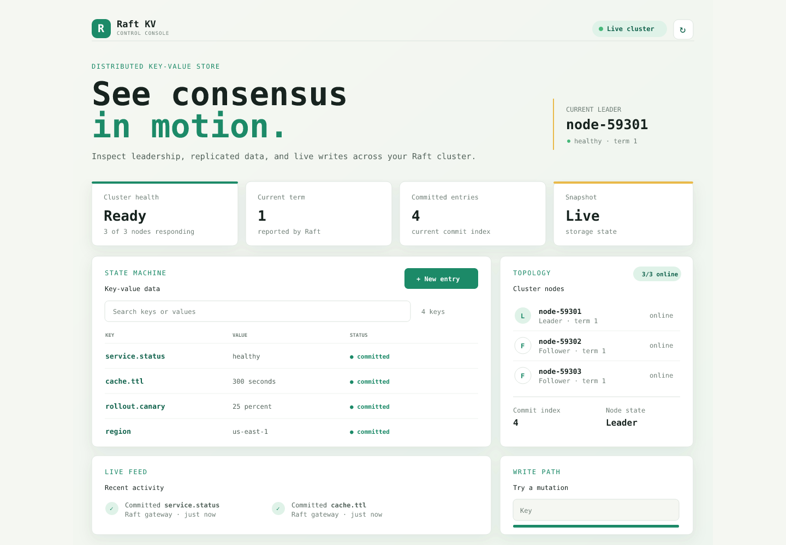
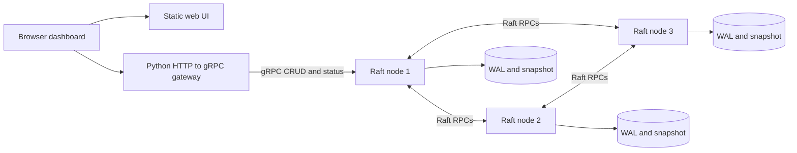

# Raft KV Store

**A hands-on distributed key-value store built with C++17, Raft, gRPC, and Protocol Buffers.**

The project demonstrates leader election, majority-committed writes, durable recovery, and a
browser-based operator dashboard. It is designed as an educational and hackathon demo, not as a
production database.



<p align="center"><sub>Operator dashboard showing cluster health, Raft node roles, and key-value operations.</sub></p>

## What it demonstrates

- **Raft leader election:** nodes elect a leader using terms, votes, and randomized election timeouts.
- **Replicated writes:** a leader commits writes after acknowledgement from a majority of the configured
  static cluster, then applies committed entries to its key-value state.
- **Recovery:** nodes persist Raft metadata and a write-ahead log (WAL), replay committed operations on
  restart, and use snapshots to compact old log entries.
- **Failure handling:** followers can catch up from a leader; the integration suite exercises replication,
  persistence, leader failover, and forwarding.
- **Browser console:** a Python HTTP gateway translates dashboard requests into gRPC calls to the C++
  service.
- **Optional security and operations features:** mutual TLS, dashboard accounts with isolated key
  namespaces, JSON backup/restore, health endpoints, and request counters.

## Architecture



See [the architecture guide](docs/ARCHITECTURE.md) for the write path, RPC roles, and persistence
details.

## Run the demo

With CMake, a C++17 compiler, gRPC, Protocol Buffers, and GoogleTest installed:

```bash
cmake -S . -B build
cmake --build build --parallel
ctest --test-dir build --output-on-failure
./start.sh
```

Open **http://localhost:4173** for the dashboard. The launcher starts three Raft nodes, a gateway
on port `8080`, and the static UI on port `4173`. Stop the stack with:

```bash
./stop.sh
```

For Windows setup, manual cluster commands, Codespaces, and troubleshooting, see
[Build and demo guide](docs/BUILD-AND-DEMO.md). For test coverage and additional verification
commands, see [Testing guide](docs/TESTING.md).

## Technology

| Area | Technology |
|---|---|
| Storage service and Raft implementation | C++17 |
| Node and client communication | gRPC |
| RPC contracts and log serialization | Protocol Buffers |
| Build and C++ tests | CMake, GoogleTest, CTest |
| Dashboard API gateway | Python, gRPC Python |
| Dashboard | HTML, CSS, JavaScript |

## Repository map

| Path | Purpose |
|---|---|
| `server.cpp` | Raft node, gRPC service, replication, persistence, and recovery |
| `client.cpp` | Command-line gRPC client |
| `proto/kvstore.proto` | RPC service and message definitions |
| `gateway.py` | Browser-facing HTTP gateway |
| `web/` | Operator dashboard |
| `start.sh`, `stop.sh` | Local demo lifecycle |
| `tests/` | C++ integration/configuration and Python gateway tests |
| `benchmarks/` | Basic end-to-end write throughput client |

## Important limitations

Cluster membership is static; reloading peer endpoints does not implement safe Raft membership
changes. Dashboard authentication does not authenticate direct gRPC clients. `EVENTUAL` reads can
be stale, and the project's current behavior has not been independently validated as production
safe. Keep the demo on trusted networks and use disposable data.

Read [the consistency model](docs/CONSISTENCY-MODEL.md) and
[production readiness notes](docs/PRODUCTION-READINESS.md) before considering any deployment
beyond local experimentation.

## License

MIT. See [LICENSE](LICENSE).
