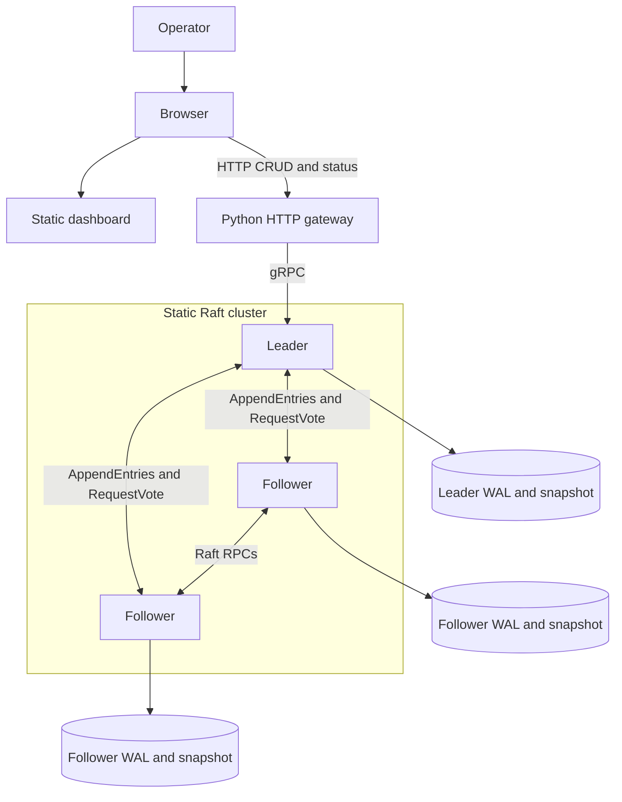
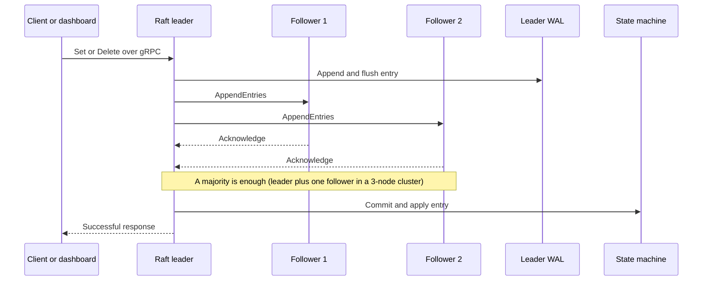

# Architecture

The system is a static-membership Raft cluster with a C++ gRPC service on each node. The dashboard
is a separate browser client: a small Python gateway translates its HTTP requests into the existing
gRPC API.

## Component view

Each node runs the same service implementation. The leader is elected dynamically; ports do not
assign permanent roles. In the default demo, `start.sh` launches three nodes, the UI on port `4173`,
and the gateway on port `8080`.

## Write and commit path

The leader appends a log entry, replicates it to peers, and applies it to the in-memory key-value
state only after a majority has acknowledged it. Successful write semantics and caveats are
described in the [consistency model](CONSISTENCY-MODEL.md).

## Raft RPCs

The service contract is defined in [`proto/kvstore.proto`](../proto/kvstore.proto).

| RPC | Role |
|---|---|
| `RequestVote` | Candidates request votes during leader election. |
| `AppendEntries` | Leaders replicate log entries and send heartbeats. |
| `InstallSnapshot` | Leaders transfer compacted state to a lagging node. |
| `Get`, `Set`, `Delete`, `ListKeys` | Client key-value operations. |
| `GetClusterStatus` | Reports node role, term, leader, and commit index. |

## Persistence and recovery

Each node writes to its own directory under the configured data root:

- `raft.meta` stores election metadata such as the current term and vote.
- `raft.wal` stores length-prefixed protobuf log records.
- `raft.snapshot` stores compacted state and request-deduplication data.

On restart, the service loads its snapshot and replays the remaining WAL entries. Snapshot
compaction bounds the amount of historical log data that must be retained. Keep backups before
changing runtime versions; an on-disk rolling upgrade procedure is not currently supported.

## Membership and security boundaries

Membership is configured statically at startup. A watched peer file can rebuild outbound
connections, but this is **not** Raft joint consensus and must not be used to change the voting
membership of a running cluster. Direct gRPC access is unauthenticated unless mutual TLS is
configured; dashboard login only protects the HTTP gateway. See the
[production readiness notes](PRODUCTION-READINESS.md).
